# GDGoC UNSRI Core Team & Member Management API

[](https://github.com/akira4n/Backend-GDGoC-UNSRI-CaseStudy/actions/workflows/ci.yml)
[](https://nodejs.org/)
[](https://expressjs.com/)

Infrastruktur REST API production-ready yang dibangun untuk manajemen Core Team dan anggota GDGoC Universitas Sriwijaya (UNSRI). Sistem ini mengotomatiskan administrasi komunitas, pemantauan aktivitas anggota, perencanaan kegiatan dengan garansi Zero-Overbooking Concurrency, pencatatan kehadiran yang Idempoten, serta Audit Trail untuk perubahan data sensitif.

---

## Daftar Isi

- [Arsitektur & Clean Code](#arsitektur--clean-code)
- [Akun Pengujian](#akun-pengujian)
- [Panduan Menjalankan Aplikasi](#panduan-menjalankan-aplikasi)
  - [Opsi 1: Docker Compose](#opsi-1-docker-compose)
  - [Opsi 2: Manual Local Node.js](#opsi-2-manual-local-nodejs)
- [Rangkaian Pengujian Otomatis](#rangkaian-pengujian-otomatis)
- [Daftar Endpoint API](#daftar-endpoint-api)
- [Dokumentasi API](#dokumentasi-api)
- [Variabel Lingkungan](#variabel-lingkungan)

---

## Arsitektur

Sistem mengadopsi prinsip Layered Clean Architecture dengan pemisahan tanggung jawab (Separation of Concerns):

```mermaid
flowchart LR
    Client([Client / Postman / Reviewer]) --> CORS[CORS Middleware]
    CORS --> RateLimiter[Tiered Rate Limiter]
    RateLimiter --> Router[Express Router]
    Router --> AuthGuard[JWT Auth & RBAC Guard]
    AuthGuard --> Validator[Zod Validation Middleware]
    Validator --> Controller[Module Controller]
    Controller --> Service[Business Logic Service]
    Service --> Repository[Prisma Repository Pattern]
    Repository --> Database[(PostgreSQL 18)]
```



- **Routes (`src/modules/*/routes.js`)**: Deklarasi endpoint yang menghubungkan middleware CORS, autentikasi JWT, otorisasi RBAC, rate limiting, dan validasi input.
- **Controllers (`src/modules/*/controller.js`)**: Mengatur parsing request HTTP, memanggil service layer, dan memformat respon seragam.
- **Services (`src/modules/*/service.js`)**: Pusat aturan bisnis (pengecekan kuota & waktu event, validasi jendela waktu absensi, kalkulasi slug otomatis, pemicuan audit log, dan mitigasi IDOR).
- **Repositories (`src/modules/*/repository.js`)**: Abstraksi akses database menggunakan Prisma 7 dengan direct Promise delegation (tanpa redundant async/await).

---

## Akun Pengujian

Database otomatis terisi (auto-seeded) dengan 3 akun pengujian untuk setiap tingkatan hak akses:

| Role            | Email                      | Password      | Hak Akses Utama                                                                     |
| :-------------- | :------------------------- | :------------ | :---------------------------------------------------------------------------------- |
| `LEAD`          | `lead@gdgoc-unsri.org`     | `password123` | Akses penuh: manajemen role anggota, soft delete, audit trail, kelola event & kuota |
| `DIVISION_HEAD` | `head.web@gdgoc-unsri.org` | `password123` | Kelola anggota divisi, buat & edit event, absensi kehadiran                         |
| `MEMBER`        | `member@gdgoc-unsri.org`   | `password123` | Melihat event publik, mendaftar event, check-in absensi                             |

---

## Panduan Menjalankan Aplikasi

### Opsi 1: Docker Compose

Menjalankan seluruh sistem (API + PostgreSQL 18 + Auto Migration + Auto Seeding) dengan satu perintah:

```bash
docker compose up --build
```

Setelah container siap:

- API menyala di: `http://localhost:3000/api`
- Health check: `http://localhost:3000/api/health`
- Database PostgreSQL 18 diisolasi di dalam network `app-network` tanpa membuka port ke publik.
- Migrasi database (`npx prisma migrate deploy`) dan seeding akun reviewer (`prisma/seed.js`) berjalan otomatis saat startup.

Untuk menghentikan dan mereset environment:

```bash
docker compose down -v
```

---

### Opsi 2: Manual Local Node.js

Prasyarat: Node.js 24+ dan PostgreSQL 18 lokal.

1. Instal Dependencies:
   ```bash
   npm ci
   ```
2. Setup Konfigurasi Environment:
   ```bash
   cp .env.example .env
   ```
3. Jalankan Migrasi Database & Seeder:
   ```bash
   npx prisma generate
   npx prisma migrate deploy
   npm run db:seed
   ```
4. Jalankan Server:
   ```bash
   node src/server.js
   ```

---

## Rangkaian Pengujian Otomatis

Aplikasi dilengkapi dengan 60 Automated Tests (33 Unit Tests + 27 Integration Tests) yang menguji seluruh logika bisnis kritis:

```bash
npm test
npm run test:unit
npm run test:integration
npm run lint
```

Area Kritis yang Diuji:

1. **Quota Concurrency (`tests/integration/quota.test.js`)**: Menguji 5 request pendaftaran simultan via `Promise.all()` pada event dengan sisa kuota 2. Sistem menjamin tepat 2 request berhasil dan 3 request ditolak HTTP 409 (Zero Overbooking, `registered_count = 2`).
2. **Attendance Idempotency (`tests/integration/attendance.test.js`)**: Menguji check-in berulang dari peserta yang sama. Sistem mengembalikan status 200 OK dengan ID presensi yang identik tanpa menduplikasi data di database.
3. **Closed Registration Guard (`tests/unit/event.service.test.js`)**: Menguji penolakan otomatis (HTTP 400) saat pengguna mendaftar pada event yang sudah melewati waktu selesai (`endTime`).
4. **RBAC & Soft Delete (`tests/integration/user-rbac.test.js`)**: Menguji penolakan hak akses MEMBER pada rute manajemen, proteksi akun diri sendiri dari deaktivasi, dan pemblokiran token bagi akun yang di-soft delete.

---

## Daftar Endpoint API

Seluruh endpoint diawali dengan prefix `/api`:

| Method   | Endpoint                            | Hak Akses               | Deskripsi                                                 |
| :------- | :---------------------------------- | :---------------------- | :-------------------------------------------------------- |
| `GET`    | `/health`                           | Public                  | Status kesehatan server API                               |
| `POST`   | `/v1/auth/register`                 | Public                  | Pendaftaran anggota baru (default role: `MEMBER`)         |
| `POST`   | `/v1/auth/login`                    | Public                  | Autentikasi akun & penerbitan token JWT                   |
| `GET`    | `/v1/users`                         | `LEAD`, `DIVISION_HEAD` | Daftar pengguna dengan pagination, filter, search, & sort |
| `PATCH`  | `/v1/users/:id/role`                | `LEAD`                  | Mengubah role pengguna (tercatat di Audit Log)            |
| `DELETE` | `/v1/users/:id`                     | `LEAD`                  | Soft delete pengguna (tercatat di Audit Log)              |
| `GET`    | `/v1/events`                        | Public                  | Daftar event aktif dengan pagination & filter             |
| `GET`    | `/v1/events/:identifier`            | Public                  | Detail event berdasarkan UUID atau slug URL               |
| `POST`   | `/v1/events`                        | `LEAD`, `DIVISION_HEAD` | Membuat event baru dengan auto-generated slug             |
| `PATCH`  | `/v1/events/:id`                    | `LEAD`, `DIVISION_HEAD` | Memperbarui event (audit log aktif jika kuota berubah)    |
| `DELETE` | `/v1/events/:id`                    | `LEAD`, `DIVISION_HEAD` | Menghapus event (snapshot tersimpan di Audit Log)         |
| `POST`   | `/v1/events/:id/register`           | Authenticated           | Pendaftaran event atomik (anti-overbooking)               |
| `POST`   | `/v1/attendances/:eventId/check-in` | Authenticated           | Absensi kehadiran idempoten pada jendela waktu event      |
| `GET`    | `/v1/audit-logs`                    | `LEAD`                  | Riwayat audit trail perubahan data sensitif               |

---

## Dokumentasi API

Format dokumentasi API interaktif tersedia di root repositori:

### 1. Postman Collection & Environment (v2.1 JSON)

- **Collection**: [postman_collection.json](./postman_collection.json) (14 Endpoint terstruktur per modul).
- **Environment**: [postman_environment.json](./postman_environment.json) (Variabel URL & Kredensial Pengujian).

Cara Penggunaan:

1. Buka aplikasi Postman, klik tombol **Import**, lalu pilih kedua file di atas.
2. Pilih environment **"GDGoC UNSRI API (Local Environment)"** di pojok kanan atas.
3. Jalankan request `Login as LEAD`. Token JWT otomatis tersimpan ke variabel `{{token}}` via Test Script bawaan, sehingga endpoint terproteksi dapat langsung diuji tanpa menyalin token manual.
4. Fitur **Run Collection** dapat digunakan untuk mengeksekusi seluruh endpoint sekaligus.

### 2. OpenAPI 3.0 Specification

- File spesifikasi standar: [openapi.json](./openapi.json).
- Dapat diimpor langsung ke Swagger Editor (editor.swagger.io) atau API client lainnya.

---

## Variabel Lingkungan

File `.env` mendukung konfigurasi runtime berikut:

| Variabel         | Default / Contoh         | Deskripsi                                                |
| :--------------- | :----------------------- | :------------------------------------------------------- |
| `PORT`           | `3000`                   | Port listening server Express                            |
| `NODE_ENV`       | `production`             | Lingkungan runtime (`development`, `test`, `production`) |
| `DATABASE_URL`   | `postgresql://...`       | Connection string PostgreSQL dengan pooling              |
| `JWT_SECRET`     | `super-secure-secret...` | Kunci rahasia penandatanganan token JWT                  |
| `JWT_EXPIRES_IN` | `7d`                     | Masa berlaku token akses JWT                             |
